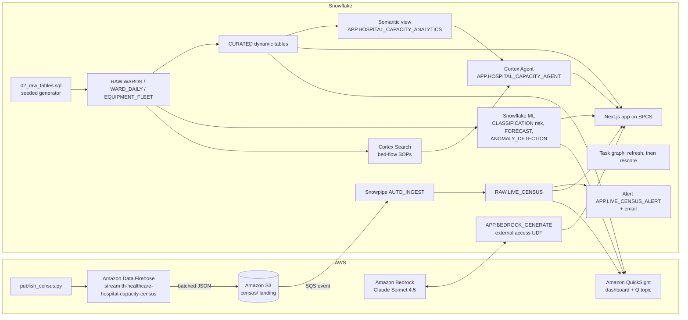

# Thailand Hospital Bed Capacity - Occupancy, Placement and Overflow Risk

End-to-end bed capacity analytics for **40 wards in a fictional Thai private hospital group across 5 cities** (Bangkok, Chiang Mai, Khon Kaen, Phuket, Hat Yai) using Snowflake, optionally with AWS: from a live bed-census alert to a 7-day capacity overflow risk score, an alert email and an AI action memo for the bed management team. All data is synthetic and ward-level: there are no patient records, no patient identifiers, no diagnoses and no clinical findings.

## Architecture

A bed capacity pipeline built on **Snowflake** (Dynamic Tables, Snowflake ML, Cortex Search, Cortex Agent, Cortex AI_COMPLETE, SPCS) and, in the full build, **AWS** (Amazon Data Firehose, S3, Bedrock Claude, QuickSight + Amazon Q). Bed-census events land in `RAW.LIVE_CENSUS`. Dynamic tables curate 90 days of ward-day history: bed occupancy against staffed beds, admissions against plan, admissions placed in a bed within the placement target, bed-management escalations, confirmed capacity overflows, overflow reviews, boarding time and bed-flow audit compliance. Snowflake ML scores 7-day overflow risk per ward, forecasts daily admissions and flags boarding-time anomalies. A Cortex Agent answers questions with SOP citations, and an LLM drafts the bed management action memo.

Interactive diagrams (hover for object names): [Snowflake only](docs/architecture-snowflake.html) | [AWS + Snowflake](docs/architecture-aws.html). The app shows both on its Architecture & Data tab, the current build first. Regenerate them with `python3 docs/build_architecture.py`.



The Snowflake-only build drops the AWS subgraph: `APP.SIMULATE_CENSUS` writes to `RAW.LIVE_CENSUS`, and the app calls Cortex `AI_COMPLETE` instead of the Bedrock UDF.

## Snowflake Capabilities

| Capability | Implementation |
|-----------|---------------|
| Dynamic Tables | `CURATED.KPI_SUMMARY`, `PERFORMANCE_SUMMARY`, `DRIVER_SUMMARY`, `TREND_ANALYSIS` from the RAW tables |
| Snowflake ML | CLASSIFICATION 7-day capacity overflow risk (`ML.OVERFLOW_RISK_SCORES`), 14-day FORECAST of admissions, boarding-time ANOMALY_DETECTION |
| Cortex Search | 14 synthetic bed-flow SOPs (one per ward type and pressure driver) in `SEARCH.WARD_SOP_SEARCH` |
| Semantic View | `APP.HOSPITAL_CAPACITY_ANALYTICS` over wards, pressure drivers, daily totals and risk |
| Cortex Agent | `APP.HOSPITAL_CAPACITY_AGENT`: Cortex Analyst over the semantic view plus Cortex Search for SOP citations |
| Cortex AI | `AI_COMPLETE('claude-sonnet-4-5')` for grounded answers, and for the action memo in the Snowflake-only build |
| Alerts + Tasks | `APP.LIVE_CENSUS_ALERT` logs ALERT events and sends email; task graph `TASK_REFRESH_CURATED`, then `TASK_RESCORE_RISK` |
| Snowpark Container Services | Next.js app `APP.TH_HEALTHCARE_HOSPITAL_CAPACITY_APP` with 6 tabs: Executive Cockpit, Predictive, Bed-Flow Risk, Live Census, Ask AI, Architecture & Data |
| Snowpipe | `RAW.LIVE_CENSUS_PIPE` AUTO_INGEST from S3 (AWS build only) |

## AWS Services

Used only in the AWS + Snowflake build.

| Service | Role in Demo |
|---------|-------------|
| Amazon Data Firehose | Direct PUT Firehose stream `th-healthcare-hospital-capacity-census` receives simulated bed-census events and writes batches to S3 |
| Amazon S3 | Landing bucket (`census/`). An event notification goes to the Snowpipe SQS queue |
| Amazon Bedrock | Claude Sonnet 4.5 writes the action memo, called from Snowflake through an external-access UDF |
| Amazon QuickSight | DIRECT_QUERY executive dashboard over Snowflake (daily admissions and escalations, confirmed capacity overflows by ward, overflow risk) |
| Amazon Q | Natural-language questions over the QuickSight topic `th-healthcare-hospital-capacity-topic` |
| AWS IAM | Least-privilege roles for S3, Firehose and Bedrock |

## Personas

These personas are fictional.

| Persona | Role | Key Questions |
|---------|------|---------------|
| **Siriporn Chaiyasit** | Group Director of Bed Management | "Which cities and ward types are running closest to staffed capacity?" "Which pressure drivers turn into confirmed overflows?" |
| **Nattapong Wongsuwan** | Ward Operations Lead | "Which wards are high risk this week, and which SOP applies?" |

## Data

All data is synthetic and seeded, so every rebuild reproduces it. The hospital group, wards and names are fictional. Tables hold ward-level daily counts only: there are no patient records, no patient identifiers, no diagnoses and no clinical notes, and nothing in this demo is a diagnostic, clinical or medical-efficacy claim.

| Table | Rows | Description |
|-------|------|-------------|
| RAW.WARDS | 40 | Wards across 5 Thai cities and 5 ward types (Medical, Surgical, ICU, Maternity, Paediatric), with staffed beds, service tier, nurse FTE and 90-day admissions plan |
| RAW.WARD_DAILY | 3,600 | Daily ward capacity over 90 days: admissions and admissions placed in target, midnight census against staffed beds, bed-management escalations, confirmed capacity overflows, overflow reviews, pressure driver, bed-flow audits, boarding hours and admissions awaiting a bed |
| RAW.EQUIPMENT_FLEET | 40 | Bedside equipment type, units installed, units safety-checked and checks pending per ward |
| SEARCH.WARD_SOP_DOCS | 14 | Synthetic bed-flow SOPs indexed for Cortex Search |
| RAW.LIVE_CENSUS | Grows during the demo | Live bed-census events from Firehose (AWS build) or `APP.SIMULATE_CENSUS` (Snowflake-only build) |
| ML.OVERFLOW_RISK_SCORES | 40 | 7-day capacity overflow probability and risk band per ward |

## Build Instructions

### Prerequisites
- Snowflake account with ACCOUNTADMIN access, and Cortex AI enabled (AI_COMPLETE, Search, Agent).
- An X-Small warehouse with auto-suspend at or below 120 s, and an existing SPCS compute pool.
- Python 3.11+, `snowflake-connector-python`, Node.js 22+, Docker and the `snow` CLI.
- App image: run `snow spcs image-registry login`, then build and push `th-healthcare-hospital-capacity-app:v1` to the database's `APP.IMAGES` repository (see the header of `snowflake/07_deploy_app.sql`).
- AWS build only: `boto3`, AWS credentials for the target account (us-west-2) with Bedrock access, and QuickSight Enterprise.

### SPCS App
```
<DATABASE>.APP.TH_HEALTHCARE_HOSPITAL_CAPACITY_APP
```

### Tests
```bash
python -m pytest aws snowflake quicksight
```

For a local run, put `SNOWFLAKE_ACCOUNT`, `SNOWFLAKE_USER`, `SNOWFLAKE_DATABASE`, `SNOWFLAKE_WAREHOUSE`, `SNOWFLAKE_AUTHENTICATOR=PROGRAMMATIC_ACCESS_TOKEN`, `SNOWFLAKE_TOKEN` and `DEMO_PLATFORM` in the environment, then run `npm --prefix app run build && npm --prefix app start`.
## Build Modes

Both modes share the same core. They differ in three places, and the app's `DEMO_PLATFORM` setting (in its SPCS spec) switches the memo provider and the Live Census tab.

| Layer | Snowflake Only | Full AWS + Snowflake |
|---|---|---|
| Live bed census | `CALL APP.SIMULATE_CENSUS(n)` inserts simulated bed-census events into `RAW.LIVE_CENSUS`. This simulates a bed-management system feed; it is not Snowpipe Streaming | `aws/publish_census.py` to Amazon Data Firehose, then S3, SQS and Snowpipe AUTO_INGEST |
| Action memo | Cortex `AI_COMPLETE('claude-sonnet-4-5')` | Amazon Bedrock Claude Sonnet 4.5 through `APP.BEDROCK_GENERATE` |
| BI and natural-language questions | The SPCS app is the dashboard; questions go to the Cortex Agent | Also a QuickSight dashboard and an Amazon Q topic |
| App setting | `DEMO_PLATFORM: snowflake` | `DEMO_PLATFORM: aws` |

### Snowflake Only

```bash
# 1. Core data and dynamic tables (guarded: new isolated database only)
python snowflake/run_core.py --database THAILAND_HEALTHCARE_HOSPITAL_CAPACITY_SNOWFLAKE --warehouse <XS_WAREHOUSE> --connection <CONNECTION> --apply
# 2. Native bed-census feed, ML, search, semantic view, agent, alert and task graph
python snowflake/run_intelligence.py --database THAILAND_HEALTHCARE_HOSPITAL_CAPACITY_SNOWFLAKE --platform snowflake --warehouse <XS_WAREHOUSE> --connection <CONNECTION> --alert-email you@example.com
# 3. App on SPCS with DEMO_PLATFORM=snowflake (push the image first)
python snowflake/run_intelligence.py --database THAILAND_HEALTHCARE_HOSPITAL_CAPACITY_SNOWFLAKE --platform snowflake --warehouse <XS_WAREHOUSE> --connection <CONNECTION> --alert-email you@example.com --files 07_deploy_app.sql --compute-pool <COMPUTE_POOL>
```

During the demo:
- Run `CALL APP.SIMULATE_CENSUS(20)` to add live bed-census events. For a continuous feed, run `ALTER TASK APP.TASK_SIMULATE_CENSUS RESUME`, and `SUSPEND` it afterwards.
- Run `EXECUTE ALERT APP.LIVE_CENSUS_ALERT` to raise the alert email.
- Run `EXECUTE TASK APP.TASK_REFRESH_CURATED` to refresh the curated tables and rescore risk.

Afterwards, drop the database or run `ALTER SERVICE APP.TH_HEALTHCARE_HOSPITAL_CAPACITY_APP SUSPEND`.

### Full AWS + Snowflake

```bash
# 1. Core data and dynamic tables (guarded: new isolated database only)
python snowflake/run_core.py --database THAILAND_HEALTHCARE_HOSPITAL_CAPACITY_AWS --warehouse <XS_WAREHOUSE> --connection <CONNECTION> --apply
# 2. AWS ingestion and Bedrock (dry run first, then --apply)
python aws/setup_aws.py --database THAILAND_HEALTHCARE_HOSPITAL_CAPACITY_AWS --account <AWS_ACCOUNT_ID> --connection <CONNECTION> --apply
# 3. ML, search, semantic view, agent, alert and task graph
python snowflake/run_intelligence.py --database THAILAND_HEALTHCARE_HOSPITAL_CAPACITY_AWS --platform aws --warehouse <XS_WAREHOUSE> --connection <CONNECTION> --alert-email you@example.com
# 4. App on SPCS with DEMO_PLATFORM=aws (push the image first)
python snowflake/run_intelligence.py --database THAILAND_HEALTHCARE_HOSPITAL_CAPACITY_AWS --platform aws --warehouse <XS_WAREHOUSE> --connection <CONNECTION> --alert-email you@example.com --files 07_deploy_app.sql --compute-pool <COMPUTE_POOL>
# 5. QuickSight dashboard and Q topic (needs an existing Snowflake data source)
python quicksight/build_dashboards.py --database THAILAND_HEALTHCARE_HOSPITAL_CAPACITY_AWS --account <AWS_ACCOUNT_ID> --principal-arn <QUICKSIGHT_USER_ARN> --data-source-arn <DATA_SOURCE_ARN> --prefix th-healthcare-hospital-capacity --apply --update --with-topic
```

QuickSight objects must be shared with the QuickSight user who signs in (`--principal-arn`); otherwise the console shows nothing.

During the demo:
- Run `python aws/publish_census.py --count 20` to send live bed-census events. Firehose buffers for up to 60 seconds before writing to S3.
- Run `EXECUTE ALERT APP.LIVE_CENSUS_ALERT` to raise the alert email.
- Run `EXECUTE TASK APP.TASK_REFRESH_CURATED` to refresh the curated tables and rescore risk.

Afterwards, `python aws/teardown_aws.py --database THAILAND_HEALTHCARE_HOSPITAL_CAPACITY_AWS --account <AWS_ACCOUNT_ID> --connection <CONNECTION> --apply` removes the AWS resources and the account-level Bedrock external-access and S3 storage integrations. It leaves the email integration `TH_HEALTHCARE_HOSPITAL_CAPACITY_EMAIL_INT`, which the Snowflake-only build also uses.

## Business Impact

Snowflake customer outcomes:
- **NYC Health + Hospitals** (Snowflake customer), the largest municipal health system in the United States, says: "With Snowflake, our end-to-end data delivery time for membership and claims data has improved from five days to five minutes." It stores more than 100 billion rows of healthcare data in Snowflake -- [Snowflake customer story: NYC Health + Hospitals](https://www.snowflake.com/en/customers/all-customers/case-study/nyc-health/)

## Key Demo Numbers

These figures are synthetic and come from the seeded demo data. Forecast and anomaly figures can shift slightly with the build day.

- **40 wards** with **1,182 staffed beds**, 3,600 ward-days over 90 days, across 5 Thai cities and 5 ward types
- **Bed occupancy 82.9%** of staffed bed-days; Bangkok runs highest at 83.6% and Khon Kaen lowest at 82.3%
- **23,391 admissions** against the 90-day plan, so admissions are at **99.9% of plan**; 5 wards are below 95% of plan
- **26.8% of admissions placed outside the placement target**; average boarding time **4.1 hours**; 6,681 admissions awaiting a bed at day end in total
- **660 bed-management escalations** raised and **244 confirmed** as capacity overflows, a 37.0% escalation confirmation rate; **106 overflow reviews** opened
- **Bed turnaround** produces the most confirmed overflows (58 of 99 escalations); the 16 bed-board system outage escalations are never confirmed
- **Overflow risk model** out-of-time holdout (600 ward-days): precision 0.50, recall 0.39 at a 0.5 threshold, against a 0.31 base rate. Eleven wards are high risk; the top one is WARD-0028, at 96.5%
- **14-day forecast** of 250 to 259 admissions per day, with prediction intervals; **40 of 640** ward-days flagged as boarding-time anomalies
- **Bed-flow audit compliance 77.0%**, equipment safety-check coverage 66.3%, with 15 checks pending
- **14 SOPs** indexed for Cortex Search and cited by ID in agent answers

## License

Apache 2.0 — See [LICENSE](LICENSE) for details.

This is a personal demo project and is not an official Snowflake offering. It comes with no support or warranty. It uses synthetic data only and provides no medical, diagnostic, clinical or regulatory advice. The hospital group, wards and personas are fictional. The Snowflake customer story cited above is a reported outcome and not a guarantee of results.
